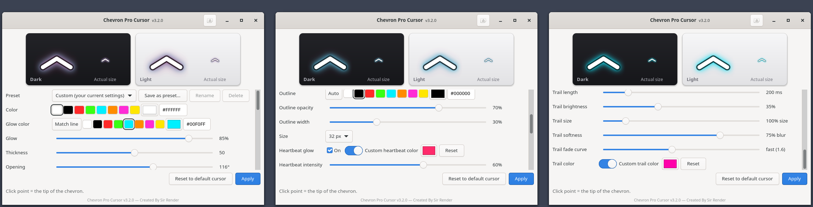
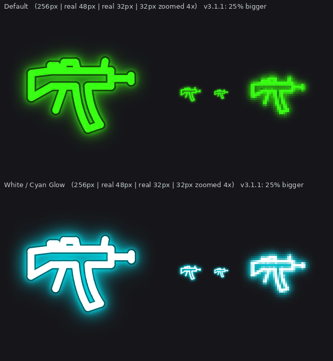
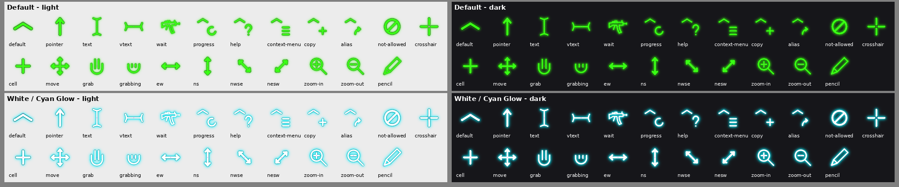
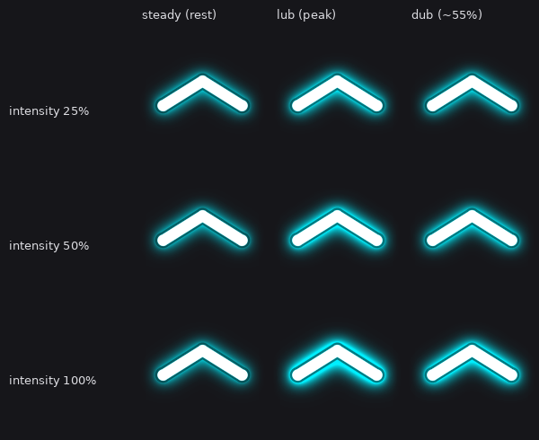
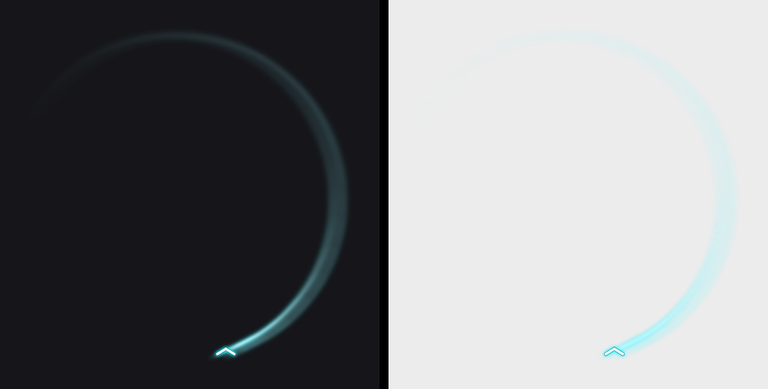

# Chevron Pro Cursor

**A sharp, glowing crosshair cursor for Omarchy with real motion blur.**

This crosshair is perfect for FPS players and has a Cyberpunk 2077 style motion blur. Tweak it, make it yours, mod it, and have fun with it.

Chevron Pro Cursor replaces your Hyprland pointer with a clean open-chevron sight. Clicks land exactly on the tip. It comes with a full matching cursor set, so resize arrows, the text cursor, hand, grab and the rest all fit the same look.

- **Motion blur trail:** fast flicks leave a smooth streak of the cursor itself that fades like light across your eyes. Slow, precise movement stays clean.
- **Heartbeat glow:** an optional double-beat pulse with adjustable intensity, heart rate and its own color.
- **Rifle reload busy cursor:** while an app is loading, an original line-art rifle drops its mag, seats a new one and racks the charging handle.
- **Full control:** set the color, glow, outline, thickness, size and angle (60°–150°). Every value has a slider, and you can double-click to type an exact number.
- **Presets:** 11 built in, plus save, rename and delete your own.
- **Light on resources:** the trail stays idle until you move fast and stays lightweight even on older hardware.
- **Clean install and uninstall:** a top-bar button goes wherever you choose, and one command removes everything and restores your old cursor.

*Created by Sir Render.*

## Install
From git:

    git clone https://github.com/Guitarmang89/chevron-pro-cursor.git
    cd chevron-pro-cursor
    ./install.sh                                  # asks where to put the top-bar button (1-5, 0 = none)

Or download the release tarball (includes the prebuilt themes, so the install is faster):

    curl -LO https://github.com/Guitarmang89/chevron-pro-cursor/releases/download/v3.2.0/chevron-pro-cursor-v3.2.0.tar.gz
    tar xzf chevron-pro-cursor-v3.2.0.tar.gz && cd chevron-pro-cursor
    ./install.sh

Options: `./install.sh --bar-position center-right` (or `left | center-left | center-mid | center-right | right | none`),
`./install.sh --no-launch`. From a git clone the 11 prebuilt themes are built on the first install (about 30 s).

The installer checks for `python python-gobject python-cairo gtk4 gtk4-layer-shell python-pillow`
and offers to install any that are missing with pacman. Then it installs:

| What | Where |
|---|---|
| **Chevron Pro Cursor** app (launcher: Super+Space) | `~/.local/bin/chevron-pro-picker` |
| `chevron-pro-cursor` command-line tool | `~/.local/bin/chevron-pro-cursor` |
| `chevron-pro-trail` trail daemon | `~/.local/bin/chevron-pro-trail` |
| engine + uninstaller | `~/.local/share/chevron-pro-cursor/` |
| 11 prebuilt themes, one per built-in preset | `~/.local/share/icons/ChevronPro-<Preset>` |

The launcher entry, the bar button, the trail autostart and the post-install open always run the copies
inside `~/.local/share/chevron-pro-cursor/`; the `~/.local/bin` commands are only a terminal convenience.
The installer records each shared file it places (sha256, or the exact target of a symlink) in
`~/.local/share/chevron-pro-cursor/installed-files`. A reinstall, upgrade or uninstall only replaces or
removes a shared path whose current identity still matches that record; anything that already existed,
or was replaced or edited after install, is left alone (`./install.sh --force` replaces it anyway).

Then it opens the app. Pick a preset or design your own and press **Apply**. Log out and back in
once after the first Apply so every app picks up the cursor.

**Upgrading** from v1/v2 (called "Chevron Cursor"): just run `./install.sh`. Your settings and
saved presets move to `~/.config/chevron-pro-cursor` (a copy of the old folder is kept in
`migrated-from-v2/`), and the old app, themes (`Sight-Chevron*`), Hyprland snippet, source line,
autostart line and running trail daemon are removed. If the old cursor was active, it is rebuilt as
`ChevronPro` with your settings. A running trail daemon is restarted with the new version.

## The app
- **Preset:** 11 built-ins (Default, High Contrast, Neon Cyan, Red Sight, White / Cyan Glow, Night Vision,
  Gold / Orange Glow, Pink / Purple Glow, Stealth Black, Wide Scope, Sharp Arrow), plus your own:
  **Save as preset…**, **Rename**, **Delete** (built-ins are read-only). Saved in `~/.config/chevron-pro-cursor/presets.json`.
- **Color**, **Glow** and **Glow color** (Match line, swatches, chooser or hex), **Thickness**, **Opening** (60°–150°).
- **Outline:** color (Auto, swatches, chooser or hex), opacity 0–100 %, width 0 up to the line's width.
- **Size:** 24, 32, 48, 64 or 96.
- **Heartbeat glow:** on/off, **Custom heartbeat color** (switch, color button, **Reset**; off = the pulse is the
  glow color), **Heartbeat intensity** 0–100 % and **Heart rate** 50–120 BPM (default 60) as full sliders (see below).
- **Exact values:** every slider shows its value next to it; **double-click the number** to type one, then press
  Enter (or click elsewhere) to apply it. Typed values are clamped to the slider's range; Esc cancels.
- **Cursor trail:** on/off, sensitivity, length, brightness, **Trail size**, softness (blur at the tail), fade curve, and
  **Trail color**: by default the trail is the cursor's own colors; turn on **Custom trail color** to pick one
  (**Reset** goes back to the cursor's colors). Presets save and restore the trail color choice. Changes apply live.
- **Preview:** drawn as vectors at your screen's real resolution (never an upscaled bitmap): a dark and a light
  panel with the zoomed chevron and the cursor at actual size (v3.1: 30 % larger, bigger labels); the heartbeat
  animates when it's on, in its own color if you picked one.
- **Window:** opens floating, centred, compact: 38 % of the monitor width × half its height (a Hyprland window
  rule in our snippet; color and button rows wrap instead of scrolling sideways on narrow screens); the header-bar
  button (or F11) expands it to full screen and back. The settings scroll.
- **Apply** builds the theme `ChevronPro` (~/.local/share/icons), runs `hyprctl setcursor`, writes
  `~/.config/hypr/chevron-pro-cursor.conf` (sourced from hyprland.conf) and sets the GTK cursor. On Omarchy 4.x
  (Lua config) it also writes `~/.config/hypr/chevron-pro-cursor.lua`, loaded from `hyprland.lua` by a marked block.

## Top-bar button
One click opens the settings (`chevron-pro-cursor open`: absolute path, started detached with `uwsm app --` in a
uwsm session, else `setsid`). Positions: left (end of the left group), center-left / center-mid / center-right
(start / middle / end of the center group), right (start of the right group), or none. It has 10 px of margin.
- **Omarchy 3.x (Waybar):** edits `~/.config/waybar/config.jsonc` as text (comments and formatting kept; the module
  definition sits in a `// >>> chevron-pro-cursor` block), adds a marked rule to `style.css`, keeps a
  `.chevron-pro-cursor.bak` backup, and restarts Waybar. Removing it restores the files byte for byte.
- **Omarchy 4.x (omarchy-shell):** adds a `command` widget to `~/.config/omarchy/shell.json` (bar sections left,
  centerBegin, center, centerEnd, right) and runs `omarchy-shell shell reloadConfig`.
- Change it any time: `chevron-pro-cursor bar --position right` (or `none`).
- **Reset to default cursor** brings back the cursor you had before and turns the trail off.

## Full cursor set
Every theme has 23 shapes in the same style: default, pointer, text, vertical-text, help, context-menu,
copy, alias, not-allowed, crosshair, cell, move, grab, grabbing, the four resize arrows, zoom-in/out, pencil, and two animations:
- **wait / watch:** a line-art carbine that drops its magazine, holds empty for 0.5 s, loads a new one,
  racks the charging handle, settles and rests for 1 s (~2.5 s loop).
- **progress / left_ptr_watch:** the chevron with a small spinner, 24 frames, ~0.8 s per turn.

All X11, CSS and Wayland cursor names map to these, including the hash aliases and Hyprland's border-resize names.

## Heartbeat glow
The main cursor's glow pulses like a heartbeat, **on top of** the normal steady glow: between beats it is
exactly your normal glow; each "lub" boosts it (v3.1: 25 % stronger, up to about 2.25× the glow and a 25 % wider halo at
100 %), and the "dub" ~220 ms later is about 55 % as strong. The loop is 60000 / BPM ms (1 s at 60 BPM).
At 0 % intensity the cursor is static.
**Heartbeat color:** by default the pulse is the glow color; with **Custom heartbeat color** on, the boost is
drawn in your color, blended over the steady glow (settings `heartbeat_color_custom`, `heartbeat_color`; presets
save and restore it). Only the main cursor pulses; the other shapes keep the steady glow.

## Cursor trail
`chevron-pro-trail` draws a motion blur of the cursor itself (its real image: color, glow, outline, angle), like
a light swept across your eyes, only when you move the mouse fast. It fades smoothly from head to tail and gets
softer toward the tail; there are no visible copies.
- **Sensitivity:** 0 = only a real flick (~3800 px/s), 60 (default) ≈ 1750 px/s, 100 = any motion.
  Speed is measured over 40 ms in logical pixels, so it means the same on 1× and HiDPI monitors.
  Once triggered it keeps drawing until the speed drops below 60 % of the threshold, then fades out.
- **How:** the cursor image is pre-rendered once at half resolution; along the resampled path at most 28 copies
  are placed, each already smeared over its share of the path (straight or curved), so they add up to one even
  streak. Smears are cached, so nothing is allocated per frame. Very fast or long trails are drawn at about a third
  of the resolution. A click-through overlay per monitor; the cursor position comes from Hyprland's IPC at ~240 Hz;
  redraws follow the frame clock, only around the streak, and stop when nothing is visible (idle ≈ 0 % CPU).
- The app's switch starts/stops it and adds/removes its `exec-once` line so it starts at login.

## Command line
    chevron-pro-cursor presets                       # list built-in and saved presets
    chevron-pro-cursor apply --preset "Red Sight" --size 32
    chevron-pro-cursor apply --color White --glow 70 --glow-color Cyan --thickness 50 --opening 116 \
        --outline-color Black --outline-opacity 60 --outline-width 25 --size 32
    chevron-pro-cursor apply --heartbeat on --heartbeat-intensity 60 --heartbeat-bpm 72
    chevron-pro-cursor apply --heartbeat-color "#FF2A6A"   # own pulse color (#hex or preset name); "glow" = glow color
    chevron-pro-cursor save-preset "My Sight"        # saves your current settings
    chevron-pro-cursor rename-preset "My Sight" "Night Owl"
    chevron-pro-cursor delete-preset "Night Owl"
    chevron-pro-cursor trail on|off
    chevron-pro-cursor trail-color "#FF2A2A"         # custom trail color; "cursor" = follow the cursor's colors
    chevron-pro-cursor bar --position center-right   # top-bar button (left|center-left|center-mid|center-right|right|none)
    chevron-pro-cursor open                          # open the settings window (detached)
    chevron-pro-cursor use ChevronPro-NeonCyan 32    # switch to a prebuilt theme
    chevron-pro-cursor reset
    chevron-pro-cursor version

## Uninstall
    ~/.local/share/chevron-pro-cursor/uninstall.sh   # or: chevron-pro-cursor uninstall, or ./install.sh --uninstall

It stops the trail daemon and removes the app, CLI, daemon, launcher entry and icon, the trail autostart line,
`~/.config/hypr/chevron-pro-cursor.conf`/`.lua` and their include lines in hyprland.conf/hyprland.lua, the top-bar
button (Waybar or omarchy-shell) and its backups, and all `ChevronPro*` cursor themes, plus any leftovers of the old "Chevron Cursor"
(v1/v2). It then restores the cursor you had before installing (theme and size, via hyprctl, gsettings and
`~/.local/share/icons/default/index.theme`; Adwaita 24 if unknown) and asks:

    Also delete your settings and saved presets (~/.config/chevron-pro-cursor)? [y/N]

Use `--purge` to delete them without asking, or `--keep-settings` to keep them. Log out and back in afterwards.

## What's new in 3.2.0 (final release)
- More compact window: 38 % of the monitor width (was 50 %), tighter margins and smaller swatches; the preview
  keeps its size (it only scales down if the window is narrower than it). The Hyprland rule and Lua snippet match.
- Footer credit in the app: "Chevron Pro Cursor v3.2.0 — Created By Sir Render" (version read from `VERSION`).

## What's new in 3.1.1
- The reload busy cursor (wait / watch / clock) is drawn 25 % bigger on its own 25 % larger canvas (e.g. 40 px at
  size 32), hotspot still centred. Timing, frames and all other cursors are unchanged.

## What's new in 3.1.0
- Preview 30 % larger with readable labels; Heart rate and Intensity are full draggable sliders.
- Double-click any slider value to type an exact number.
- Fixed: **Custom trail color** made the trail disappear. The tint code multiplied the color by the pixel's alpha
  (0–255) without dividing by 255, so channel values overflowed a byte, building the trail sprites failed and no
  trail was drawn. Now covered by a test that renders a custom color.
- Heartbeat 25 % stronger, with an optional separate heartbeat color (`--heartbeat-color`).

## Development
    python3 -m unittest discover -s tests      # trail, bar (Waybar/omarchy-shell), Hyprland snippet, settings tests
    python3 build-prebuilt.py && python3 verify.py   # build + check every theme with libXcursor
    python3 verify.py --extremes               # also 60°/150° themes at max thickness, glow, outline, heartbeat
    ./trail-preview.py docs/trail-preview.png  # offline render of the trail

## Credits
Chevron Pro Cursor is created by **Sir Render**.

## License
MIT. See [LICENSE](LICENSE). Copyright (c) 2026 Sir Render.
